<a href="README.md">中文</a>

## 👋 Hi, I’m Huijie Li (Iris)

**New graduate | AI Builder & Creator** 
**Vibe Coding enthusiast | Slow Variables · Technology writing** 
**Exploring AI products and agents, and turning interesting ideas into things people can try.**

I enjoy exploring AI products, agents, and creative tools. I write about technology and everyday life on my WeChat publication, **慢变量AI / Slow Variables**.

🌐 [My website](https://tonghuyen3234y-del.github.io/hj/en/home/) · 🚗 [Explore the town](https://tonghuyen3234y-del.github.io/hj/en/drive/) · ✍️ [Writing](https://tonghuyen3234y-del.github.io/hj/en/home/#writing)

---

## ⭐ Selected projects

| Project | What it does | Source & demo |
| --- | --- | --- |
| **Moshu · AI Application Platform** | Connects knowledge bases, agents, evaluation, publishing, and runtime tracing, with case feedback for regression checks | [Source & screenshots](https://github.com/tonghuyen3234y-del/moshu-ai-platform#readme) |
| **Product Scene Studio** | Upload a product image, choose a scene, then generate and download images with Dify, Supabase, and Vercel | [Source](https://github.com/tonghuyen3234y-del/product-scene-studio) · [Demo](https://product-scene-studio-sooty.vercel.app/) |
| **Tech Video Script Skill** | A Codex skill for checking technology news and preparing five titles, a short script, and source links | [Install & source](https://github.com/tonghuyen3234y-del/tech-video-script) · [Overview](https://tonghuyen3234y-del.github.io/tech-video-script/) |
| **Xingtu Interactive Landing Page** | A bilingual frontend recreation exploring 3D visuals, photo interactions, and responsive design | [Source](https://github.com/tonghuyen3234y-del/xingtu-landing) · [Demo](https://tonghuyen3234y-del.github.io/xingtu-landing/) |
| **Huijie’s Space** | A bilingual personal town with writing, ideas, and a driving exploration mode | [Source](https://github.com/tonghuyen3234y-del/hj) · [Step inside](https://tonghuyen3234y-del.github.io/hj/) |

## 🧩 Practice & tools

I use AI coding tools to explore prototypes and interactions, and write about what I learn along the way.

## ✍️ Selected writing

- [DeepSeek vs. MiniMax: Is cheaper AI really better value?](https://mp.weixin.qq.com/s/-7A6BenYm8seHDT0keUjEQ)
- [AI can already code on its own. What should four years at university teach us?](https://mp.weixin.qq.com/s/yjDNopiw4RT6CGZwwFwl-Q)
- [Two hours of Hongguo a day: How close are we to Amusing Ourselves to Death?](https://mp.weixin.qq.com/s/63wP56oHuWgKfjFgUZLOzA)
- [DeepSeek lets AI direct AI. Reading the technical paper gave me chills.](https://mp.weixin.qq.com/s/TY5RQpJ6Zyw6dyVXN6H_3g)

### Slow Variables · AI & Beyond

> Technology is accelerating. Thinking can take its time.

Find **慢变量AI** in WeChat for my writing on large language models, agents, AI products, and the way technology changes people and society.

---

<code>STAY CURIOUS. KEEP CREATING.</code>

