  

点击上方招牌，走进我的个人小镇 · 主页模式 / 3D Drive 探索模式

<a href="README.en.md">

## 👋 你好，我是李慧洁

我喜欢尝试 AI 产品、Agent 与新的创作工具，也用文字记录对科技与生活的观察。 
这里收录我的 AI 应用、写作 Skill 和网页交互实践。

`EXPLORE` 探索 AI　·　`CREATE` 动手实践　·　`WRITE` 记录思考

🌐 [个人网站](https://tonghuyen3234y-del.github.io/hj/) · 🚗 [开车逛好奇小镇](https://tonghuyen3234y-del.github.io/hj/drive/) · ✍️ [科技写作](https://tonghuyen3234y-del.github.io/hj/home/#writing) · 💬 微信公众号 **慢变量AI**

---

## ⭐ 代表作

| 项目 | 它解决什么 | 源码与演示 |
| --- | --- | --- |
| 🗂️ **墨枢 · AI 应用中台** | 连接知识库、Agent、评测与发布，用运行追踪和 Case 回流持续检查应用质量 | [源码与界面](https://github.com/tonghuyen3234y-del/moshu-ai-platform#readme) |
| 🖼️ **商品场景图生成器** | 上传商品图，选择场景，生成并下载场景图片；使用 Dify、Supabase 与 Vercel | [源码](https://github.com/tonghuyen3234y-del/product-scene-studio) · [在线体验](https://product-scene-studio-sooty.vercel.app/) |
| 🎙️ **科技口播写作 Skill** | 核实科技新闻，整理五个标题、一段口播和来源链接，在 Codex 中使用 | [安装与源码](https://github.com/tonghuyen3234y-del/tech-video-script) · [介绍页](https://tonghuyen3234y-del.github.io/tech-video-script/) |
| 🎞️ **醒图双语交互落地页** | 练习双语切换、3D 视觉、照片交互与响应式页面 | [源码](https://github.com/tonghuyen3234y-del/xingtu-landing) · [网页演示](https://tonghuyen3234y-del.github.io/xingtu-landing/) |
| 🏡 **Huijie’s Space** | 用可探索的小镇组织个人介绍、文章与创意，支持中英文和驾驶模式 | [源码](https://github.com/tonghuyen3234y-del/hj) · [走进小镇](https://tonghuyen3234y-del.github.io/hj/) |

## 🧩 技能与标签

**实践方向** 
AI 产品探索 · Agent / Skills · 提示词设计 · RAG / 知识库 · 模型评测 · 科技写作

**使用工具** 
Codex · Dify · Supabase · Vercel · GitHub

- **AI 应用实践**　围绕知识库、Agent 和生成式应用，把想法做成可以操作的界面与流程。
- **Vibe Coding**　借助 AI 编程工具尝试原型，调整交互与使用体验。
- **科技写作**　关注大模型、AI 产品与技术变化，慢慢形成自己的判断。

## ✍️ 最近写的

- [DeepSeek和MiniMax正面交锋：便宜的AI，真的更划算吗？](https://mp.weixin.qq.com/s/-7A6BenYm8seHDT0keUjEQ)
- [AI已经可以自主写代码，大学四年究竟应该学什么？](https://mp.weixin.qq.com/s/yjDNopiw4RT6CGZwwFwl-Q)
- [每天刷红果2小时，我们离《娱乐至死》还有多远？](https://mp.weixin.qq.com/s/63wP56oHuWgKfjFgUZLOzA)
- [DeepSeek让AI指挥AI，看完技术原文我反而后背发凉](https://mp.weixin.qq.com/s/TY5RQpJ6Zyw6dyVXN6H_3g)

### 慢变量AI · Slow Variables · AI & Beyond

> 技术在加速，思考不必赶路。

我在「慢变量AI」记录 AI 技术与独立思考，关注大模型、Agent、AI 产品，以及技术发展背后人与社会的变化。

💬 在微信中搜索 **慢变量AI** · [查看文章精选](https://tonghuyen3234y-del.github.io/hj/home/#writing)

---

<code>STAY CURIOUS. KEEP CREATING.</code> 保持好奇，持续创造。

